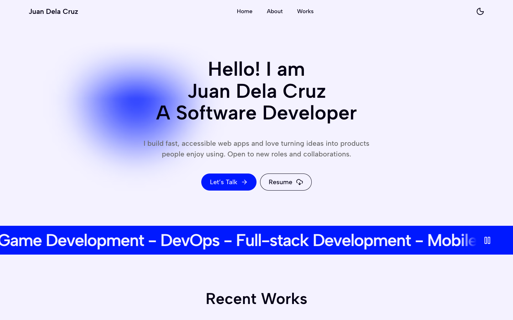

# Plinth

A clean, accessible developer portfolio you make your own by editing one file. It's built with Next.js, TypeScript and Tailwind CSS, and there's no backend, no API keys and no environment variables to set up.

<picture>
  <source media="(prefers-color-scheme: dark)" srcset="docs/screenshot-dark.png" />
  
</picture>

**Live demo:** [plinthfolio.vercel.app](https://plinthfolio.vercel.app)

[](https://vercel.com/new/clone?repository-url=https%3A%2F%2Fgithub.com%2Fleigharriane%2FPlinth&project-name=plinth&repository-name=plinth)

## Features

| Feature               | What you get                                                                                                                                                                                                                                                                 |
| --------------------- | ---------------------------------------------------------------------------------------------------------------------------------------------------------------------------------------------------------------------------------------------------------------------------- |
| One config file       | Every word, link and image on the page comes from `plinth.config.ts`. It's fully typed, so your editor tells you when something's missing.                                                                                                                                   |
| Light and dark themes | They follow the visitor's system setting, and there's a toggle too.                                                                                                                                                                                                          |
| Sections              | A hero with a peek at your first three projects, a skills marquee, the Recent Work carousel, about with your GitHub activity, a tech stack marquee, experience tabs, a contact call to action and a footer with your local time.                                             |
| Case studies          | Any project can carry a `caseStudy`: role, timeline, stack, outcomes and the story. It gets a Read case study link on the card and a static page with its own social image.                                                                                                  |
| Resume page           | `/resume` is built from your config, so it never drifts from the site. Print it or save it as a PDF from the print dialog.                                                                                                                                                   |
| Command palette       | ⌘K or Ctrl+K (or the search button in the nav) jumps to a section or project, opens the resume, copies your email, switches theme or opens a profile. It doubles as a small terminal: type `help` in it to see the commands, or `plinth` to see what the site is built with. |
| Accessible            | Semantic landmarks, visible focus, a carousel and tabs that work from the keyboard, 44px touch targets, WCAG AA contrast in both themes, and a pause button on the marquees. Motion stops completely if a visitor prefers reduced motion.                                    |
| Fast                  | Every page is prerendered, and the home page refreshes once a day to keep the GitHub cards current. Lighthouse scores 98–100 on mobile and 100 on desktop for Performance, Accessibility, Best Practices and SEO.                                                            |
| Shareable             | Page metadata, a generated social preview image and favicon, `sitemap.xml`, `robots.txt` and an `llms.txt` summary for AI assistants, all built from your config. The page also carries a `generator` tag and a one-line console note saying it's built with Plinth.         |

## Customize in 3 steps

1. **Get your own copy.** The quickest way is one command, which asks for your name, what you do and your email, then copies Plinth into a new folder with those filled in, starts a git repository and installs everything:

   ```bash
   npx create-plinthfolio my-site
   cd my-site
   npm run dev
   ```

   Or click **Use this template** on GitHub if it's turned on (see the last section), or the Deploy button above, which copies the repo for you. Then clone it, `npm install` and `npm run dev`.

2. **Make it yours.** Put your name, links, projects and experience in `plinth.config.ts`. Then swap out the placeholder files in `public/`:

   | Path                      | What goes there                                                     |
   | ------------------------- | ------------------------------------------------------------------- |
   | `public/resume.pdf`       | Only if you'd rather link your own file than use the built-in page. |
   | `public/images/projects/` | Project thumbnails. 16:10 fits best, e.g. 1280×800.                 |
   | `public/images/logos/`    | Square company logos.                                               |

3. **Deploy.** Push to GitHub and import the repo on [Vercel](https://vercel.com/new). You don't have to configure anything: Vercel hands the site its URL for links and social previews. Using a custom domain? Set `url` in `plinth.config.ts`.

## Configuration

Everything lives in [`plinth.config.ts`](plinth.config.ts). Each field is documented in the types in [`lib/config.ts`](lib/config.ts), so you can hover a field in your editor to see what it does.

| Field                 | What it does                                                                                                                                                                                                                                                                         |
| --------------------- | ------------------------------------------------------------------------------------------------------------------------------------------------------------------------------------------------------------------------------------------------------------------------------------ |
| `icon`                | Optional. One or two letters for the favicon and the terminal's pedestal art. Defaults to your initials. The demo sets `"p"` for Plinth, so remove it on yours.                                                                                                                      |
| `name`, `role`        | Your name and job title. They show up across the page, metadata and social image.                                                                                                                                                                                                    |
| `url`                 | Optional. Your public URL. Leave it out and Vercel's production URL is used.                                                                                                                                                                                                         |
| `email`               | Where the **Let's talk** buttons send mail.                                                                                                                                                                                                                                          |
| `location`            | Optional. Where you're based, e.g. `"Manila, Philippines"`. The palette's terminal shows it in `whoami` and `date`.                                                                                                                                                                  |
| `timezone`            | Optional. Your time zone's IANA name, e.g. `"Asia/Manila"`. The footer shows your local time, and so does the terminal's `date`.                                                                                                                                                     |
| `resume`              | `"/resume"` for the page built from this config, a file in `public/`, or `null`.                                                                                                                                                                                                     |
| `hero`                | The greeting, tagline and intro paragraph, plus whether the glow follows the mouse and whether your first three project images fan out at the bottom.                                                                                                                                |
| `skills`, `techStack` | The two scrolling bands.                                                                                                                                                                                                                                                             |
| `projects`            | Carousel cards: title, description, category, year, tags, image and links. Add a `caseStudy` to give a card its own page at `/works/<slug>`.                                                                                                                                         |
| `about`               | Your paragraphs, label, headline and an optional year. Your GitHub activity shows under them, from the GitHub link in `socials`.                                                                                                                                                     |
| `experience`          | One tab per job: company, role, logo, dates and description paragraphs.                                                                                                                                                                                                              |
| `cta`                 | The heading and text above the footer.                                                                                                                                                                                                                                               |
| `socials`             | Icon links. The `SocialPlatform` type lists every supported platform. A GitHub link with your username turns on the GitHub row in about.                                                                                                                                             |
| `terminal`            | Optional. The palette's terminal: your `status` line, the day you `launched`, a `prompt`, your own `jokes`, built-ins to `disable`, and `commands` of your own that print text, open a link or run a built-in. `whatsnew` reads `CHANGELOG.md`. Set `enabled: false` to turn it off. |
| `seo.description`     | Optional. The description for search and social previews. Defaults to `hero.intro`.                                                                                                                                                                                                  |
| `seo.siteName`        | Optional. The small publisher line under the title on link previews. Defaults to `name`, which is right for your own site. The demo sets it to `"Plinth by Leigh Arriane"`, so remove it on yours.                                                                                   |

Images can be paths under `public/` or full URLs. Remote images and SVGs are served as-is, so you don't need to touch `next.config.ts`.

The GitHub row in the about section needs no token. It refreshes once a day, and if GitHub can't be reached it hides itself. If your host shares an IP that keeps hitting GitHub's rate limit, you can set an optional `GITHUB_TOKEN` environment variable.

### Colors and fonts

The palette and type scale are CSS variables at the top of [`app/globals.css`](app/globals.css), with separate light and dark values. The font is [Albert Sans](https://fonts.google.com/specimen/Albert+Sans), and it's loaded in [`app/layout.tsx`](app/layout.tsx).

## Built with Plinth

Sites on Plinth so far:

- [plinthfolio.vercel.app](https://plinthfolio.vercel.app), the demo

Built one? Add it to this list. And if you'd like to say so on your own repo, here's a badge:

[](https://github.com/leigharriane/Plinth)

```md
[](https://github.com/leigharriane/Plinth)
```

## Development

You'll need Node.js 20.9 or later.

| Command                | What it does                                                                                             |
| ---------------------- | -------------------------------------------------------------------------------------------------------- |
| `npm run dev`          | Starts the dev server on localhost:3000.                                                                 |
| `npm run build`        | Builds for production.                                                                                   |
| `npm run start`        | Serves the production build.                                                                             |
| `npm run lint`         | Runs ESLint.                                                                                             |
| `npm run typecheck`    | Type-checks with TypeScript (no emit).                                                                   |
| `npm run format`       | Formats everything with Prettier.                                                                        |
| `npm run format:check` | Checks formatting without changing files.                                                                |
| `npm run lighthouse`   | Runs Lighthouse on every page of the last build and checks it against the budgets in `lighthouserc.cjs`. |

### create-plinthfolio

`packages/create-plinthfolio` is the `npx create-plinthfolio` command. It ships a copy of this repo in its `template/` folder (ignored by git), made by `npm run sync-template` in that folder and again automatically before `npm pack` or `npm publish`, so a published version always carries the Plinth it was packed from. Its README has the publishing steps.

### Checks and releases

Two GitHub Actions run on their own. On every pull request, [Lighthouse](.github/workflows/lighthouse.yml) builds the site, checks every page against the score and size budgets in `lighthouserc.cjs`, and fails the PR if one slips. The HTML reports are attached to the run.

On every merge into `main`, [release-please](.github/workflows/release-please.yml) keeps a release PR open with the next version and its notes. Merge that PR when you're ready and it bumps the version, updates `CHANGELOG.md` and publishes the GitHub release. It writes the notes from your commit titles, so start them with `feat:`, `fix:`, `docs:` and so on. Only features, fixes, performance and docs make it into the notes. The terminal's `whatsnew` command reads that same changelog.

## For maintainers: make this a template repository

On GitHub, open **Settings → General** and tick **Template repository**. That gives people a **Use this template** button, so they don't have to fork.

## License

[MIT](LICENSE)
